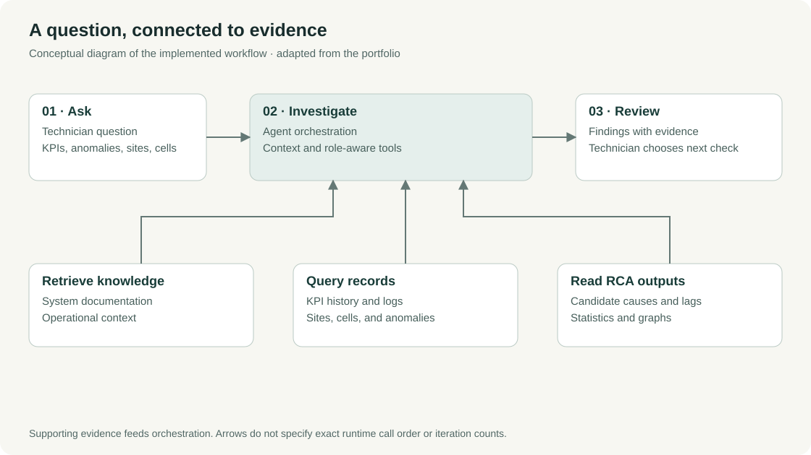
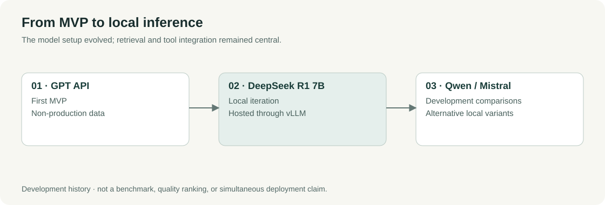

# Operational Analytics Agent

**Connecting an engineer's question to operational evidence.**

I built an assistant inside Orange Tunisia's monitoring platform that connected natural-language questions to KPI history, retrieved system knowledge, anomaly records, and root-cause analysis results. Engineers could access that evidence from the monitoring application and review findings before choosing the next diagnostic action.

**Role:** assistant implementation and platform integration · **Period:** 2025–2026

[Portfolio case study](https://oussamajaouadi.vercel.app/projects/ai-assistant-for-operational-analytics) · [Parent monitoring platform](https://github.com/oussjd2/infrastructure-monitoring-platform-case-study)

> Case study of a private internal assistant. Diagrams adapt the portfolio's conceptual diagrams of the implemented workflow. Internal code, prompts, datasets, and production conversations remain private.

## Why it was built

Technicians manually checked logs, historical records, and KPIs to investigate issues. The assistant brought those sources into a query-driven interaction inside the existing product. Its useful capability came from connecting the model to system knowledge and diagnostic tools.

## How the assistant works

1. **Ask:** an engineer asks about KPIs, anomalies, a site, a cell, or an incident through the application.
2. **Assemble context:** combine relevant system knowledge and investigation context.
3. **Use tools:** role-aware access connects to operational records, KPI history, anomalies, and existing RCA results.
4. **Return evidence:** bring together findings, supporting records, candidate causes, and suggested next checks.
5. **Review:** the technician examines the evidence and decides what to investigate next.

The diagram summarizes the lifecycle; tool selection and context depend on the question.

## Retrieval, tools, and diagnosis

| Source | What it contributes | Role in an answer |
|---|---|---|
| Retrieved system knowledge | Documentation and platform-specific context | Explain terminology and interpret the question in the system's context |
| Operational tools and indices | Sites, cells, KPI history, logs, and anomalies | Supply records for the requested entity and period |
| RCA outputs | Ranked candidate causes, lag information, statistical values, and graphs | Support investigation of plausible relationships |
| Model and orchestration | Context assembly and response generation | Organize available evidence into findings and next steps |

The assistant consumes RCA results produced by the diagnostic subsystem. A candidate cause is an investigation lead, not proof that the assistant established an incident's physical cause.

## Model evolution

| Stage | Setup | Purpose |
|---|---|---|
| First MVP | GPT API with non-production data | Explore the interaction and integration pattern |
| Local iteration | DeepSeek R1 7B through vLLM | Move inference into the local environment |
| Comparisons | Qwen and Mistral variants | Compare alternatives during development |

Retrieval and tool integration remained central across iterations. The timeline describes development history; model-comparison benchmarks are not published.

## Engineering decisions

| Decision | Why it mattered |
|---|---|
| Combine knowledge with tool results | The system needed both platform context and evidence from operational records. |
| Integrate into the monitoring application | Engineers could ask questions where they inspected KPIs, anomalies, and diagnostic outputs. |
| Use role-aware operational access | Tool access followed the user's access context. |
| Move from API prototyping to local inference | Local-model iterations kept internal-data processing within the local environment. The initial API prototype used non-production data. |
| Keep technician review explicit | Findings and candidate causes supported an engineer's next diagnostic action. |

## What was delivered

- Conversational access to KPI history, anomalies, and RCA results from the monitoring application.
- Context assembly using system knowledge and investigation results.
- Integration between the assistant, operational tools, and role-aware application workflows.

The parent platform's investigation-time improvement is a **platform-level outcome**, not a separately measured improvement attributable to the agent.

## Evidence and boundaries

The public material documents ownership, workflow, model evolution, and integration. Production conversations, internal tool schemas, evaluation datasets, and quantitative accuracy/latency benchmarks remain outside this public case study. The visuals are architecture explanations rather than recorded operational traces.

## Stack and related work

Python · FastAPI · Haystack · Retrieval-augmented generation · Elasticsearch · vLLM · DeepSeek R1 7B · Flutter integration

- [Full agent portfolio case study](https://oussamajaouadi.vercel.app/projects/ai-assistant-for-operational-analytics)
- [Infrastructure Monitoring & Analytics Platform](https://github.com/oussjd2/infrastructure-monitoring-platform-case-study)
- [RCA, Anomaly and Forecasting Workflows](https://github.com/oussjd2/rca-anomaly-forecasting-workflows)
- [Editable diagram sources](docs/diagrams.md)
- [Visual sources and scope](docs/visual-sources.md)

**Oussama Jaouadi** · [Portfolio](https://oussamajaouadi.vercel.app) · [LinkedIn](https://www.linkedin.com/in/oussama-jaouadi-99335a1a8/)
