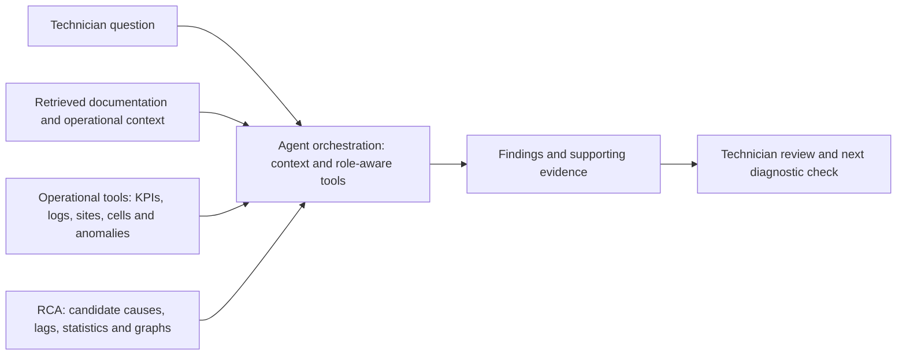
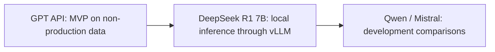

# Editable diagram sources

These diagrams adapt the portfolio's public assistant workflow and model history. SVG versions are embedded in the README; keep both representations aligned.

## Assistant workflow

This does not prescribe exact call order, a fixed tool sequence, or model iteration counts.

## Model evolution

This is development history, not a quality ranking or simultaneous deployment claim. Retrieval and tool integration remain central across iterations.
